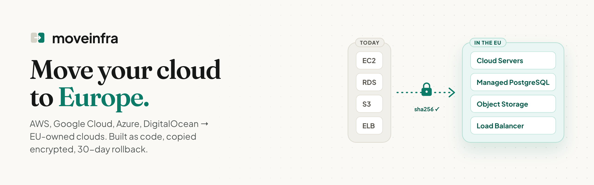

<a href="https://moveinfra.eu/"></a>

<p align="center">
  <a href="https://moveinfra.eu/"><b>moveinfra.eu</b></a> ·
  <a href="https://moveinfra.eu/demo/">Watch a migration</a> ·
  <a href="https://moveinfra.eu/eu-cloud-map/">EU Cloud Map</a> ·
  <a href="mailto:hello@moveinfra.eu">hello@moveinfra.eu</a>
</p>

We move company infrastructure from **AWS, Google Cloud, Azure and DigitalOcean** to **EU-owned clouds**
(UpCloud, Scaleway, Hetzner, OVHcloud) at a fixed price. Your network is rebuilt as Terraform, servers are copied as
encrypted disk images through a WireGuard tunnel and checked with sha256, data stays in sync until you switch, and you
can switch back within 30 days.

### Open source

<table>
<tr>
<td width="50%" valign="top">

**[cloud-exit-cost-analyzer](https://github.com/moveinfra/cloud-exit-cost-analyzer)**

What your Kubernetes cluster costs today and what it would cost on UpCloud, from real CPU and memory use.
Read-only Helm chart, nothing leaves the cluster.

```sh
helm install cost \
  oci://ghcr.io/moveinfra/charts/cloud-exit-cost-analyzer \
  -n cost-analyzer --create-namespace
```

[](https://github.com/moveinfra/cloud-exit-cost-analyzer/releases)
[](https://artifacthub.io/packages/helm/moveinfra/cloud-exit-cost-analyzer)


</td>
<td width="50%" valign="top">

**[eu-cloud-map](https://github.com/moveinfra/eu-cloud-map)**

EU-owned equivalents of AWS, Google Cloud, Azure and DigitalOcean services, as open JSON data.
Corrections and new providers welcome.

| AWS | UpCloud |
|---|---|
| EC2 | Cloud Servers |
| RDS, Aurora | Managed PostgreSQL |
| S3 | Object Storage |
| EKS | Managed Kubernetes |

[](https://github.com/moveinfra/eu-cloud-map/actions)


</td>
</tr>
</table>

<sub>Contributions welcome: each repository has a <code>CONTRIBUTING.md</code>. Security issues: Security → Report a vulnerability on the repository, or hello@moveinfra.eu.</sub>
